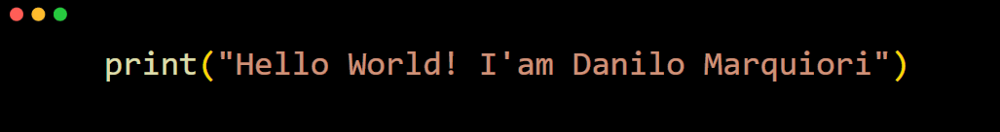

```python
class Developer:
    def __init__(self):
        self.name    = "Danilo Marquiori Baptista"
        self.age     = 28
        self.city    = "São José do Rio Preto - SP"
        self.stack   = ["Python", "RPA", "AWS", "AI/ML"]

    def bio(self):
        print(f"👋 {self.name}, {self.age} anos | {self.city}")
        print(f"🤖 Especialista em automação, RPA e cloud AWS")
        print(f"🧠 Pós-graduado em Inteligência Artificial")
        print(f"🚀 Stack: {' • '.join(self.stack)}")

Developer().bio()

```
----

## Linguagens & Tecnologias:
 

----
## Obrigado por visitar!
Agradeço por ter visitado meu perfil do GitHub. Fique à vontade para explorar meus repositórios e ver meus projetos. Sinta-se à vontade para deixar uma estrela nos projetos que você achar interessante. Espero que você encontre algo útil ou inspirador por aqui!

----
### Onde me encontrar: 👇🏼

<div>
  <a href="https://www.instagram.com/danilomarquiori/" target="_blank"></a>
  <a href="https://www.linkedin.com/in/danilomarquiori/" target="_blank"></a>
</div>

<br>

[](https://visitcount.itsvg.in)

